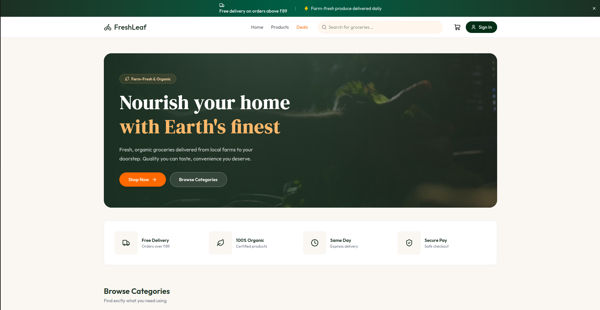
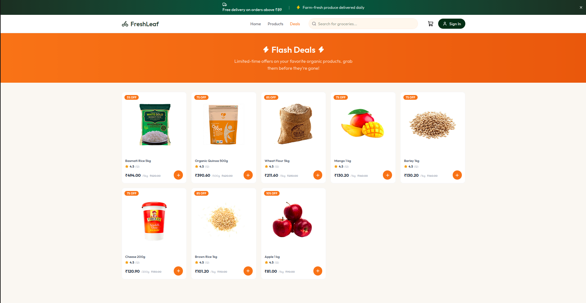
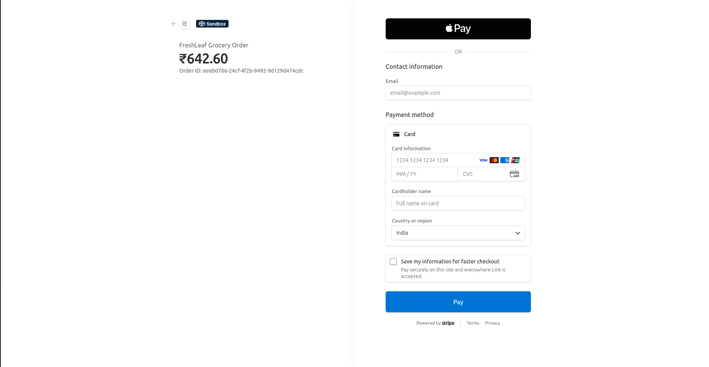
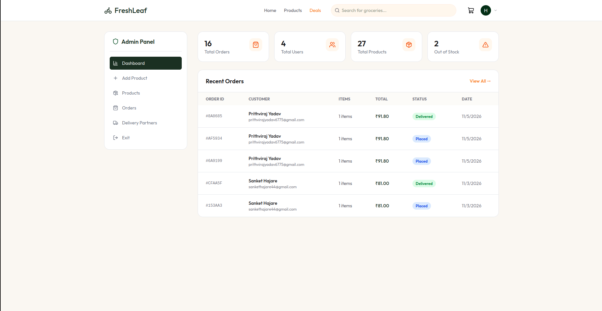
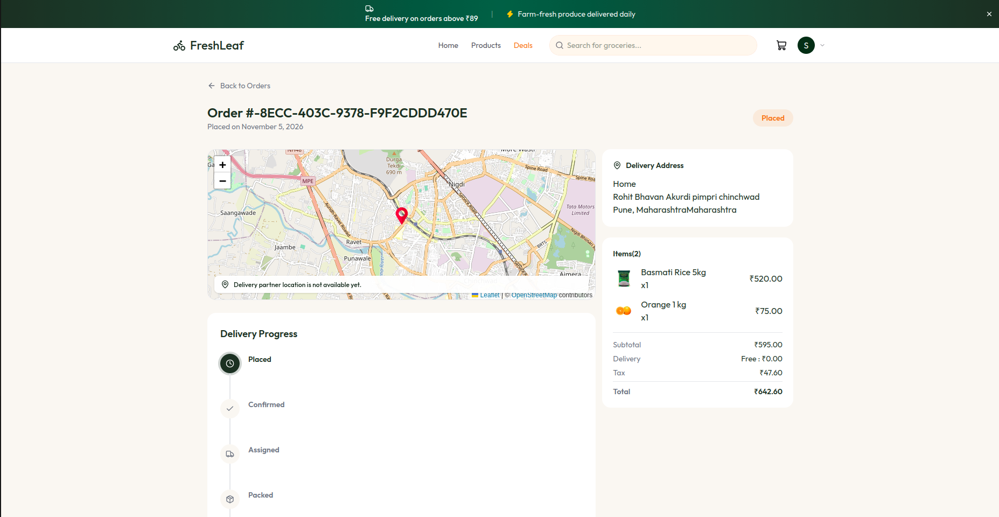
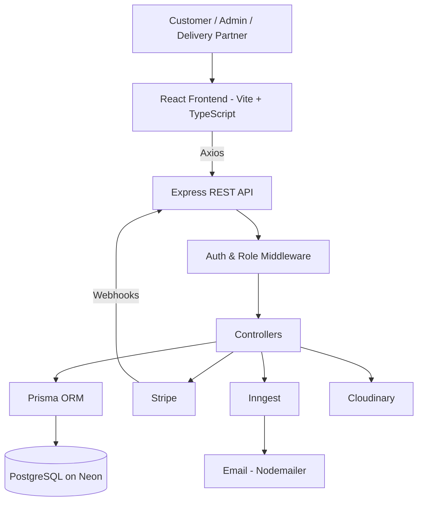
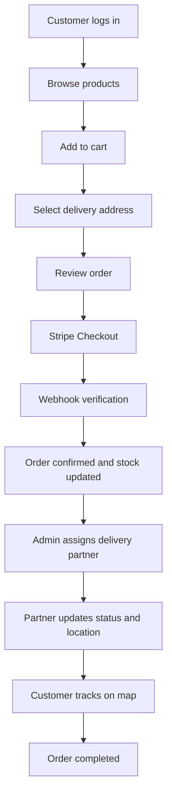
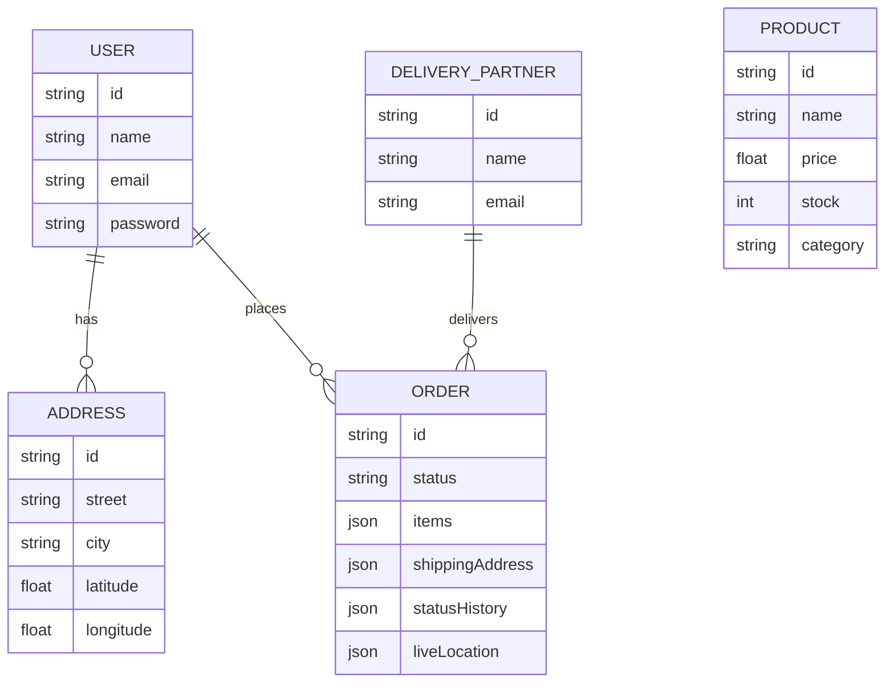
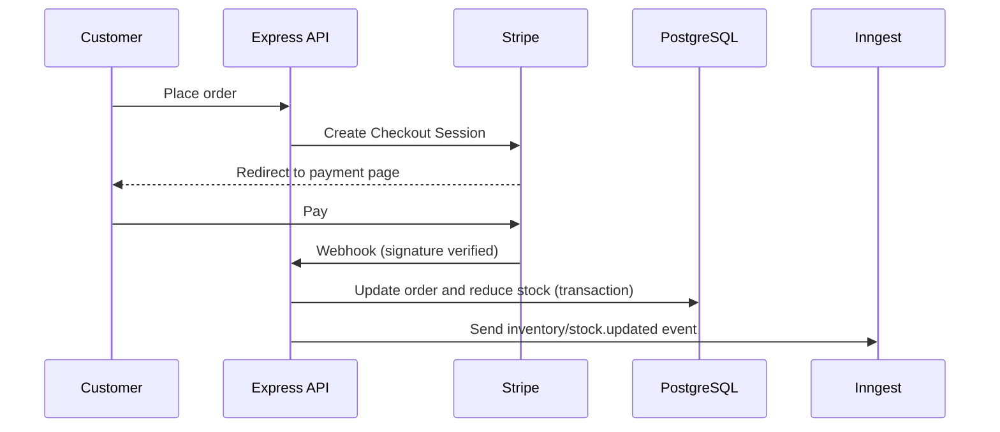

<div align="center">

# 🥬 FreshLeaf

### Fresh Groceries. Seamless Shopping. Reliable Delivery.

A full-stack grocery delivery platform with online ordering, secure Stripe payments, automated low-stock alerts, and delivery tracking, built for customers, admins, and delivery partners.

<br/>

[](https://fresh-leaf.vercel.app)
[](https://github.com/SanketHajare44/FreshLeaf)

<br/>


</div>

---

## 📖 Table of Contents

- [Overview](#-overview)
- [Live Demo & Test Accounts](#-live-demo--test-accounts)
- [Problem & Solution](#-problem--solution)
- [Key Features](#-key-features)
- [Screenshots](#-screenshots)
- [User Roles](#-user-roles)
- [Technology Stack](#-technology-stack)
- [System Architecture](#-system-architecture)
- [Application Workflow](#-application-workflow)
- [API Reference](#-api-reference)
- [Database Design](#-database-design)
- [Key Technical Implementations](#-key-technical-implementations)
- [Project Structure](#-project-structure)
- [Getting Started](#-getting-started)
- [Environment Variables](#-environment-variables)
- [Deployment](#-deployment)
- [Challenges & Learnings](#-challenges--learnings)
- [Future Improvements](#-future-improvements)
- [Author](#-author)

---

## 🥬 Overview

**FreshLeaf** is a full-stack grocery delivery application that connects three types of users through one platform:

- **Customers** browse groceries, manage a cart and addresses, pay online, and track their delivery.
- **Admins** manage products, stock, orders, and delivery partners.
- **Delivery partners** receive assigned orders, update delivery status, and share their location.

It combines a React + TypeScript frontend with an Express REST API, PostgreSQL (Neon) via Prisma, Stripe payments with webhook verification, and event-driven background jobs using Inngest.

### 🌟 Highlights

- Three dedicated experiences: customer, admin, and delivery partner.
- Secure Stripe Checkout with signature-verified webhooks.
- Stock is reduced inside a database transaction after successful payment.
- Automated low-stock email alerts for admins.
- Scheduled monthly promotional emails.
- Map-based delivery tracking with React Leaflet.
- JWT authentication with role-based authorization.

---

## 🔗 Live Demo & Test Accounts

**Live app:** [fresh-leaf.vercel.app](https://fresh-leaf.vercel.app)

Use these demo accounts to explore each role:

| Role             | Email                   | Password     |
| ---------------- | ----------------------- | ------------ |
| Customer         | `<demo-customer-email>` | `<password>` |
| Admin            | `<demo-admin-email>`    | `<password>` |
| Delivery Partner | `<demo-partner-email>`  | `<password>` |

**Test payment:** use Stripe's test card `4242 4242 4242 4242` with any future expiry date, any CVC, and any postal code.

> These are demo accounts only. No real payments are processed.

---

## 🎯 Problem & Solution

| Problem                       | FreshLeaf Solution                                          |
| ----------------------------- | ----------------------------------------------------------- |
| Inconvenient grocery shopping | Online product browsing, categories, and a shopping cart    |
| Complicated ordering          | Streamlined checkout with saved delivery addresses          |
| Payment friction              | Stripe Checkout integration                                 |
| Limited delivery visibility   | Delivery tracking on an interactive map                     |
| Manual inventory monitoring   | Automated low-stock email alerts                            |
| Delivery coordination         | Admin assignment and a dedicated delivery partner dashboard |
| Repetitive promotional emails | Scheduled email workflows with Inngest                      |

---

## 🚀 Key Features

### 👤 Customer

- Register and log in.
- Browse products, categories, and flash deals.
- View product details.
- Add, remove, and update items in the cart.
- Manage delivery addresses.
- Place orders and pay securely with Stripe.
- View order history and order details.
- Track delivery progress and the delivery partner's location on a map.

### 🛠️ Admin

- Protected admin access.
- Dashboard statistics.
- Create, update, and delete products with image upload.
- Update stock levels.
- Monitor all customer orders.
- Create and manage delivery partners.
- Assign delivery partners to orders.
- Receive automated low-stock email alerts.

### 🚚 Delivery Partner

- Separate login.
- View assigned deliveries and details.
- Update delivery status.
- Update location during delivery.
- Complete or cancel assigned deliveries.

### ⚙️ Backend & Automation

- RESTful API with controllers, routes, and middleware.
- JWT authentication and role-based authorization.
- PostgreSQL with Prisma ORM (hosted on Neon).
- Stripe Checkout and webhook handling.
- Inngest background jobs (low-stock alerts, monthly promotions).
- Image uploads with Multer and Cloudinary.
- Email notifications with Nodemailer.

---

## 📸 Screenshots

### 🏠 Home



_Hero section, delivery highlights, and product categories._

### 🛍️ Products & Flash Deals



_Grocery products with prices, ratings, discount badges, and quick add-to-cart._

### 💳 Stripe Checkout (Test Mode)



_Secure payment through Stripe Checkout, running in sandbox mode._

### 📊 Admin Dashboard



_Overview of orders, users, products, and out-of-stock items, with recent orders._

### 📍 Order Tracking



_Delivery map and order progress timeline (Placed → Confirmed → Assigned → Packed → Delivered)._

## 👥 User Roles

| Role             | Responsibilities                                                     |
| ---------------- | -------------------------------------------------------------------- |
| Customer         | Shopping, cart, checkout, payments, order tracking                   |
| Administrator    | Products, inventory, orders, statistics, delivery partner management |
| Delivery Partner | Assigned orders, status updates, location sharing                    |

---

## 🛠️ Technology Stack

### Frontend

| Technology              | Purpose                       |
| ----------------------- | ----------------------------- |
| React                   | Component-based UI            |
| TypeScript              | Type safety                   |
| Vite                    | Development and build tooling |
| Tailwind CSS            | Responsive styling            |
| React Router            | Client-side routing           |
| Axios                   | API communication             |
| Leaflet + React Leaflet | Interactive maps              |
| Lucide React            | Icons                         |
| React Hot Toast         | Notifications                 |

### Backend

| Technology           | Purpose               |
| -------------------- | --------------------- |
| Node.js + Express.js | REST API              |
| TypeScript           | Type safety           |
| Prisma ORM           | Database access       |
| JWT                  | Authentication        |
| Bcrypt               | Password hashing      |
| Multer               | Image upload handling |
| Nodemailer           | Email notifications   |

### Database & Cloud Services

| Technology        | Purpose                                 |
| ----------------- | --------------------------------------- |
| PostgreSQL (Neon) | Relational database, serverless hosting |
| Stripe            | Payments                                |
| Inngest           | Background and scheduled jobs           |
| Cloudinary        | Image storage                           |
| Vercel            | Frontend hosting                        |

---

## 🏗️ System Architecture



- **Frontend:** UI, routing, and API communication.
- **Backend:** business logic, authentication, and REST endpoints.
- **Prisma + Neon:** type-safe access to PostgreSQL.
- **Stripe:** payments and webhook events.
- **Inngest:** background and scheduled workflows.
- **Cloudinary:** product image storage.

---

## 🔄 Application Workflow



---

## 🔌 API Reference

Base URL (local): `http://localhost:5000/api`

Protected routes require a valid JWT. Admin and delivery routes require the matching role.

### Authentication: `/api/auth`

| Method | Endpoint             | Description             |
| ------ | -------------------- | ----------------------- |
| POST   | `/api/auth/register` | Register a new customer |
| POST   | `/api/auth/login`    | Log in                  |

### Products: `/api/products`

| Method | Endpoint                    | Description              | Access |
| ------ | --------------------------- | ------------------------ | ------ |
| GET    | `/api/products`             | List products            | Public |
| GET    | `/api/products/flash-deals` | List flash deals         | Public |
| GET    | `/api/products/:id`         | Get a product            | Public |
| POST   | `/api/products`             | Create a product         | Admin  |
| PUT    | `/api/products/:id`         | Update a product         | Admin  |
| PATCH  | `/api/products/:id/stock`   | Update a product's stock | Admin  |
| DELETE | `/api/products/:id`         | Delete a product         | Admin  |

### Addresses: `/api/addresses`

| Method | Endpoint             | Description         |
| ------ | -------------------- | ------------------- |
| GET    | `/api/addresses`     | Get saved addresses |
| POST   | `/api/addresses`     | Add an address      |
| PUT    | `/api/addresses/:id` | Update an address   |
| DELETE | `/api/addresses/:id` | Delete an address   |

### Orders: `/api/orders`

| Method | Endpoint                   | Description                                      |
| ------ | -------------------------- | ------------------------------------------------ |
| POST   | `/api/orders`              | Create an order                                  |
| GET    | `/api/orders`              | Get the customer's orders                        |
| GET    | `/api/orders/all`          | Get all orders (Admin)                           |
| GET    | `/api/orders/:id`          | Get order details                                |
| PUT    | `/api/orders/:id/status`   | Update order status                              |
| GET    | `/api/orders/:id/location` | Get the delivery partner's location for an order |

### Admin: `/api/admin`

| Method | Endpoint                           | Description                           |
| ------ | ---------------------------------- | ------------------------------------- |
| GET    | `/api/admin/stats`                 | Dashboard statistics                  |
| GET    | `/api/admin/delivery-partners`     | List delivery partners                |
| POST   | `/api/admin/delivery-partners`     | Create a delivery partner             |
| PUT    | `/api/admin/delivery-partners/:id` | Update a delivery partner             |
| PUT    | `/api/admin/orders/:id/assign`     | Assign a delivery partner to an order |

### Delivery Partner: `/api/delivery`

| Method | Endpoint                                   | Description              |
| ------ | ------------------------------------------ | ------------------------ |
| POST   | `/api/delivery/login`                      | Delivery partner login   |
| GET    | `/api/delivery/my-deliveries`              | List assigned deliveries |
| GET    | `/api/delivery/my-deliveries/:id`          | Get delivery details     |
| PUT    | `/api/delivery/my-deliveries/:id/status`   | Update delivery status   |
| PUT    | `/api/delivery/my-deliveries/:id/location` | Update live location     |
| PUT    | `/api/delivery/my-deliveries/:id/complete` | Mark a delivery complete |
| PUT    | `/api/delivery/my-deliveries/:id/cancel`   | Cancel a delivery        |

### Other

| Method   | Endpoint       | Description                         |
| -------- | -------------- | ----------------------------------- |
| POST     | `/api/upload`  | Upload an image to Cloudinary       |
| POST     | `/api/stripe`  | Stripe webhook handler              |
| GET/POST | `/api/inngest` | Serves registered Inngest functions |

---

## 🗄️ Database Design

FreshLeaf uses PostgreSQL (Neon) with Prisma. The diagram below is simplified.



Order items, the shipping address snapshot, status history, and live location are stored as JSON fields on `Order`. This keeps each order's details fixed even if a product or address changes later.

---

## ⚡ Key Technical Implementations

### 1. Stripe Payments and Webhooks



Handled webhook events:

- `checkout.session.completed`
- `checkout.session.expired`
- `payment_intent.payment_failed`

### 2. Inngest Background Workflows

**Low-stock alert**

- Triggered by `inventory/stock.updated`.
- Fetches the updated product and checks whether stock is below the threshold (10).
- Emails the configured admin recipients.

**Monthly promotional emails**

- Runs on a monthly schedule.
- Fetches discounted products and registered customers.
- Sends emails in batches.

### 3. Delivery Location Tracking

The delivery partner sends location updates through the delivery API. The location is stored on the order and returned to the customer through the order location endpoint. It is shown on a Leaflet map.

```text
Delivery Partner → Delivery API → Database → Order Location API → Customer Map
```

### 4. Authentication and Authorization

JWT-based authentication with separate middleware for customer, admin, and delivery partner routes. Passwords are hashed with Bcrypt.

### 5. Image Uploads

Multer handles incoming files and Cloudinary stores the product images.

---

## 📂 Project Structure

```text
FreshLeaf/
├── client/
│   ├── public/
│   ├── src/
│   │   ├── assets/
│   │   ├── components/
│   │   ├── context/
│   │   ├── pages/
│   │   ├── config/
│   │   └── types/
│   ├── package.json
│   └── vite.config.ts
│
├── server/
│   ├── config/
│   ├── controllers/
│   ├── middleware/
│   ├── routes/
│   ├── inngest/
│   ├── prisma/
│   │   └── schema.prisma
│   ├── generated/
│   ├── server.ts
│   ├── seed.ts
│   └── package.json
│
├── docs/
│   └── screenshots/
├── .gitignore
└── README.md
```

---

## 🚀 Getting Started

### Prerequisites

- Node.js (v18 or later) and npm
- Git
- A PostgreSQL database (a free [Neon](https://neon.tech) account works)
- A [Stripe](https://stripe.com) account in test mode and the [Stripe CLI](https://stripe.com/docs/stripe-cli)
- A [Cloudinary](https://cloudinary.com) account
- An SMTP account for sending email

### 1. Clone the repository

```bash
git clone https://github.com/SanketHajare44/FreshLeaf.git
cd FreshLeaf
```

### 2. Set up the backend

```bash
cd server
npm install
cp .env.example .env        # then fill in your values
npx prisma generate
npx prisma migrate deploy   # or: npx prisma db push
npm run seed                # optional: loads sample data
npm run server
```

The API runs at `http://localhost:5000`.

### 3. Set up the frontend

```bash
cd client
npm install
cp .env.example .env
npm run dev
```

Open the URL shown in the terminal (usually `http://localhost:5173`).

### 4. Run the background-job and webhook tooling (separate terminals)

```bash
# Inngest dev server
npx inngest-cli@latest dev -u http://localhost:5000/api/inngest

# Forward Stripe webhooks to your local server
stripe listen --forward-to localhost:5000/api/stripe
```

Copy the webhook signing secret printed by the Stripe CLI into `STRIPE_WEBHOOK_SECRET`.

---

## 🔐 Environment Variables

### Backend (`server/.env`)

| Variable                                                                 | Purpose                           |
| ------------------------------------------------------------------------ | --------------------------------- |
| `PORT`                                                                   | Server port                       |
| `DATABASE_URL`                                                           | PostgreSQL connection string      |
| `JWT_SECRET`                                                             | JWT signing secret                |
| `STRIPE_SECRET_KEY`                                                      | Stripe secret key                 |
| `STRIPE_WEBHOOK_SECRET`                                                  | Stripe webhook signing secret     |
| `ADMIN_EMAILS`                                                           | Recipients for low-stock alerts   |
| `CLIENT_URL`                                                             | Frontend URL (CORS and redirects) |
| `CLOUDINARY_CLOUD_NAME` / `CLOUDINARY_API_KEY` / `CLOUDINARY_API_SECRET` | Image storage                     |
| `SMTP_HOST` / `SMTP_PORT` / `SMTP_USER` / `SMTP_PASS`                    | Email sending                     |

### Frontend (`client/.env`)

```env
VITE_BASE_URL=http://localhost:5000/api
```

> ⚠️ Never commit `.env` files, API keys, database credentials, or secrets to GitHub.

---

## ☁️ Deployment

- **Frontend:** Vercel
- **Backend:** `<hosting platform>`
- **Database:** Neon (serverless PostgreSQL)

---

## 🧗 Challenges & Learnings

- **Reliable payments:** verifying Stripe webhook signatures and handling completed, expired, and failed payment events.
- **Consistent inventory:** reducing stock inside a database transaction so orders and stock stay in sync.
- **Background processing:** moving alerts and scheduled emails out of the request cycle with Inngest.
- **Multi-role access:** keeping customer, admin, and delivery partner permissions separate.
- **Maps and location:** storing and displaying a moving delivery location with Leaflet.

---

## 🔮 Future Improvements

- Automated delivery partner assignment.
- Inventory analytics.
- Push notifications for order updates.
- Detailed order status history in the UI.
- Product reviews and ratings, and a wishlist.
- Product recommendations.
- Caching and performance optimization.
- Automated tests and a CI/CD pipeline.

---

## 👨‍💻 Author

**Sanket Sadashiv Hajare**
Computer Science & Engineering Graduate | Full Stack Developer

- GitHub: [SanketHajare44](https://github.com/SanketHajare44)
- Project: [FreshLeaf](https://github.com/SanketHajare44/FreshLeaf)
- Live App: [fresh-leaf.vercel.app](https://fresh-leaf.vercel.app)

---

<div align="center">

### 🥬 FreshLeaf

**Making grocery shopping simpler and more convenient.**

If you like this project, consider giving it a ⭐ on GitHub!

</div>
